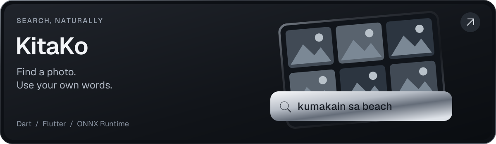
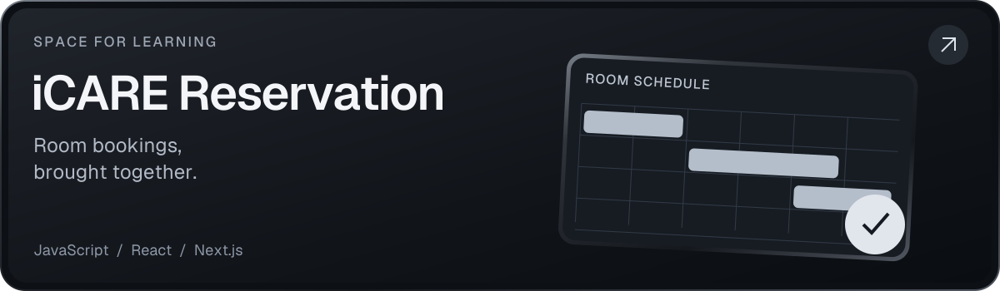
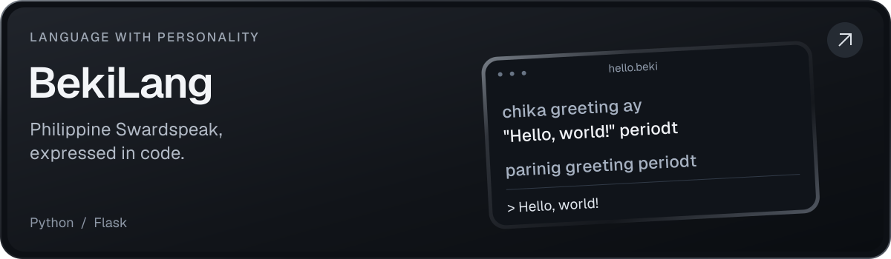
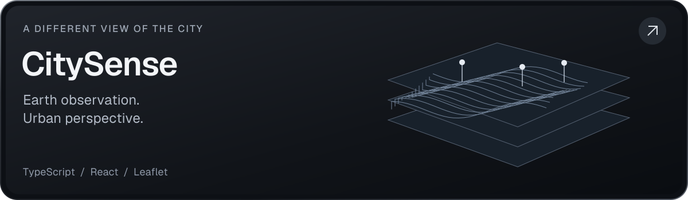
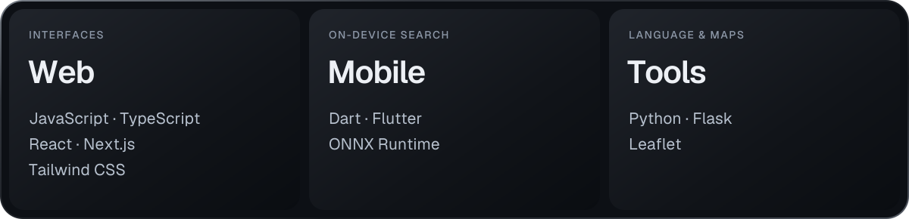

**[Portfolio](https://project-miel.vercel.app) · [GitHub](https://github.com/Emyol) · [Selected work](#selected-work)**

Hi, I’m Amiel. I build web and mobile software in Manila, Philippines, and explore ideas through code.

## Selected work

[**KitaKo**](https://github.com/Emyol/KitaKo_Codebase) — On-device semantic photo search with Taglish support. Built with Dart, Flutter, and ONNX Runtime.

[**iCARE Reservation**](https://github.com/Emyol/iCARE-Reservation) — AVR and Training Room scheduling with JavaScript, React, and Next.js.

> My work with iCARE has been part of a collective effort supporting more than **700 STEM students**.

[**BekiLang**](https://github.com/Emyol/BekiLang) — A Swardspeak-inspired programming language with a Python compiler and interpreter, and a Flask web interface.

[**CitySense**](https://github.com/Emyol/city-sense) — Earth observation layers for exploring urban heat, greenspace, water, and population. Built with TypeScript, React, Leaflet, and Vite.

*Project artwork is illustrative; it does not depict app screenshots or measured data.*

## My toolkit

**Web** — JavaScript, TypeScript, React, Next.js, Tailwind CSS  
**Mobile & image search** — Dart, Flutter, ONNX Runtime  
**Language tools & maps** — Python, Flask, Leaflet

## Elsewhere

**[Explore my portfolio](https://project-miel.vercel.app) · [Find me on GitHub](https://github.com/Emyol)**

[Public contributions](https://github.com/Emyol#year-list) — sourced from GitHub’s contribution calendar for the date range selected there.
