<!-- Art: assets/dive is built by `python tools/ocean.py`, assets/static by `python tools/build_static.py`; assets/live and the recent block are refreshed daily by .github/workflows/profile.yml. -->

<a href="https://project-miel.vercel.app">
  
</a>

<b><a href="https://project-miel.vercel.app">Portfolio</a> · <a href="https://www.linkedin.com/in/amiel-josiah-acu%C3%B1a-4786a515a">LinkedIn</a> · <a href="mailto:acunaamieljosiah@gmail.com">Email</a> · <a href="https://project-miel.vercel.app/Amiel_Acuna_CV.pdf">CV</a></b>

<picture>
  <source media="(prefers-color-scheme: dark)" srcset="assets/static/work-header-dark.svg">
  
</picture>

<a href="https://github.com/Emyol/KitaKo_Codebase">
  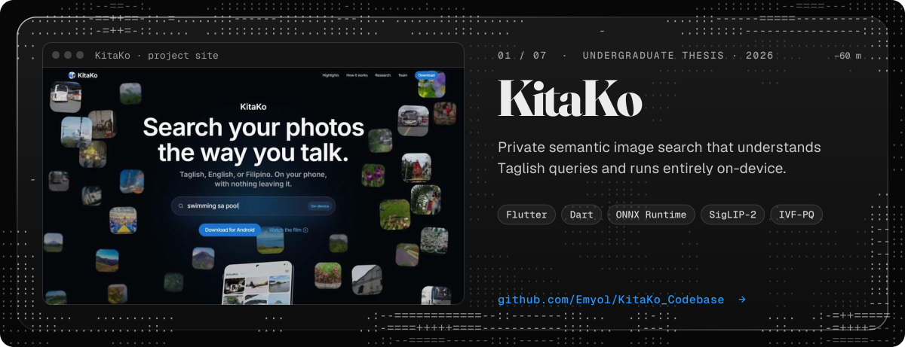
</a>

<b>KitaKo</b> · <a href="https://github.com/Emyol/KitaKo_Codebase">code</a>

<a href="https://github.com/TadeyRuk/Homestead">
  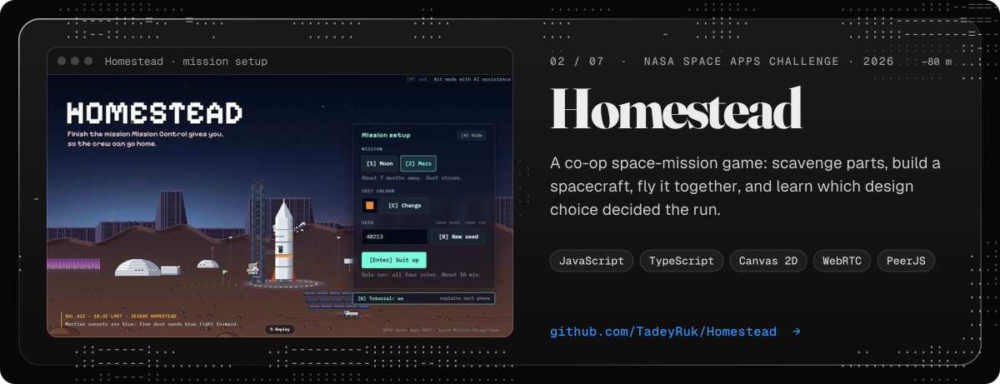
</a>

<b>Homestead</b> · <a href="https://github.com/TadeyRuk/Homestead">code</a> · <a href="https://seedlign.itch.io/homestead">live</a>

<a href="https://github.com/Seedlign/eventflow-n8n">
  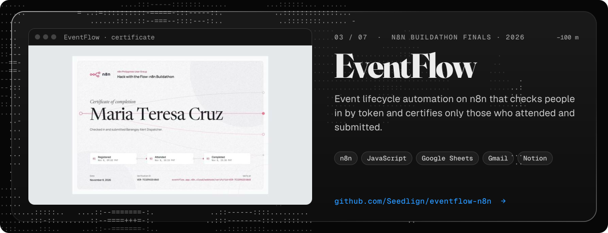
</a>

<b>EventFlow</b> · <a href="https://github.com/Seedlign/eventflow-n8n">code</a>

<a href="https://github.com/Romeo-04/kislap">
  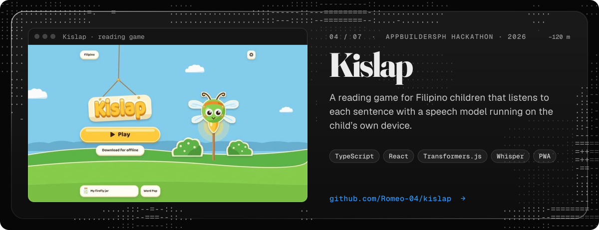
</a>

<b>Kislap</b> · <a href="https://github.com/Romeo-04/kislap">code</a> · <a href="https://romeo-04.github.io/kislap/">live</a>

<a href="https://github.com/Emyol/iCARE-Reservation">
  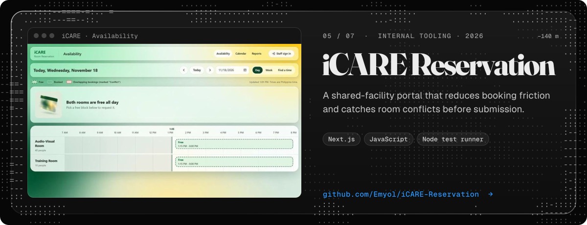
</a>

<b>iCARE Reservation</b> · <a href="https://github.com/Emyol/iCARE-Reservation">code</a>

<a href="https://github.com/Emyol/BekiLang">
  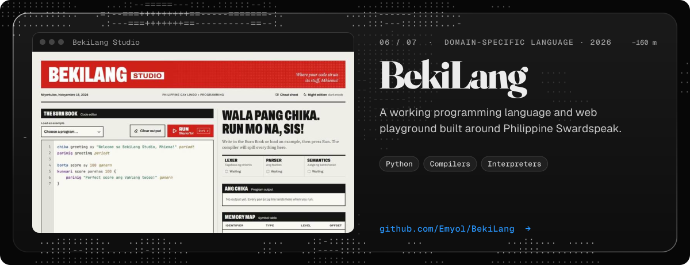
</a>

<b>BekiLang</b> · <a href="https://github.com/Emyol/BekiLang">code</a>

<a href="https://github.com/Emyol/city-sense">
  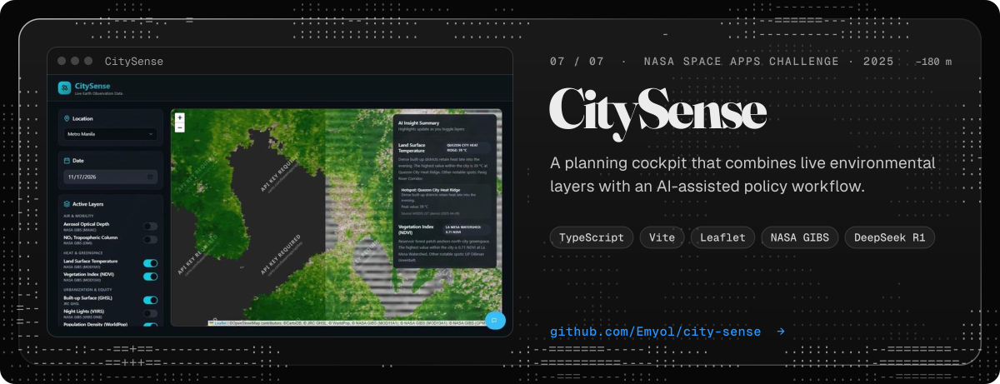
</a>

<b>CitySense</b> · <a href="https://github.com/Emyol/city-sense">code</a>

<picture>
  <source media="(prefers-color-scheme: dark)" srcset="assets/static/stack-header-dark.svg">
  
</picture>

<picture>
  <source media="(prefers-color-scheme: dark)" srcset="assets/static/stack-dark.svg">
  
</picture>

<picture>
  <source media="(prefers-color-scheme: dark)" srcset="assets/live/stats-dark.svg">
  
</picture>

<picture>
  <source media="(prefers-color-scheme: dark)" srcset="assets/static/graph-header-dark.svg">
  
</picture>

<picture>
  <source media="(prefers-color-scheme: dark)" srcset="https://raw.githubusercontent.com/Emyol/Emyol/output/github-snake-dark.svg">
  
</picture>

**Latest commits**

<!-- recent:start -->
- [`674ac6b`](https://github.com/Emyol/SA-DTR-Maker/commit/674ac6b8998a9f06814e39daedb54110cd8ea19a) **SA-DTR-Maker**: docs: update current state after push
- [`3e2a59e`](https://github.com/Emyol/SA-DTR-Maker/commit/3e2a59e729c23de884588146f28092e755221677) **SA-DTR-Maker**: docs: add project agent docs \(current state, security, discussion board\)
- [`2b78323`](https://github.com/Emyol/SA-DTR-Maker/commit/2b7832391ee45459724efa5db178473399fc7b4a) **SA-DTR-Maker**: feat: update DTR template for 1st term 2026-2027
<!-- recent:end -->

<picture>
  <source media="(prefers-color-scheme: dark)" srcset="assets/static/footer-dark.svg">
  
</picture>
