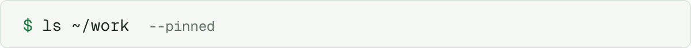

<!-- Art in assets/static is built by `python tools/build_static.py`; assets/live and the recent block are refreshed daily by .github/workflows/profile.yml. -->

<a href="https://project-miel.vercel.app">
  <picture>
    <source media="(prefers-color-scheme: dark)" srcset="assets/static/hero-dark.svg">
    
  </picture>
</a>

**[Portfolio](https://project-miel.vercel.app) · [LinkedIn](https://www.linkedin.com/in/amiel-acu%C3%B1a) · [Email](mailto:acunaamieljosiah@gmail.com)**

<picture>
  <source media="(prefers-color-scheme: dark)" srcset="assets/static/work-header-dark.svg">
  
</picture>

<a href="https://github.com/Emyol/KitaKo_Codebase">
  <picture>
    <source media="(prefers-color-scheme: dark)" srcset="assets/static/work-kitako-dark.svg">
    
  </picture>
</a>

[**KitaKo**](https://github.com/Emyol/KitaKo_Codebase): On-device semantic photo search with Taglish support.

<a href="https://github.com/Emyol/iCARE-Reservation">
  <picture>
    <source media="(prefers-color-scheme: dark)" srcset="assets/static/work-icare-dark.svg">
    
  </picture>
</a>

[**iCARE Reservation**](https://github.com/Emyol/iCARE-Reservation): AVR and Training Room scheduling with JavaScript, React, and Next.js.

<a href="https://github.com/Emyol/BekiLang">
  <picture>
    <source media="(prefers-color-scheme: dark)" srcset="assets/static/work-bekilang-dark.svg">
    
  </picture>
</a>

[**BekiLang**](https://github.com/Emyol/BekiLang): A Swardspeak-inspired programming language with a Python compiler and interpreter, and a Flask web interface.

<a href="https://github.com/Emyol/city-sense">
  <picture>
    <source media="(prefers-color-scheme: dark)" srcset="assets/static/work-citysense-dark.svg">
    
  </picture>
</a>

[**CitySense**](https://github.com/Emyol/city-sense): Earth observation layers for exploring urban heat, greenspace, water, and population.

<picture>
  <source media="(prefers-color-scheme: dark)" srcset="assets/static/stack-dark.svg">
  
</picture>

<picture>
  <source media="(prefers-color-scheme: dark)" srcset="assets/live/stats-dark.svg">
  
</picture>

<picture>
  <source media="(prefers-color-scheme: dark)" srcset="assets/static/graph-header-dark.svg">
  
</picture>

<picture>
  <source media="(prefers-color-scheme: dark)" srcset="https://raw.githubusercontent.com/Emyol/Emyol/output/github-snake-dark.svg">
  
</picture>

**`$ git log --oneline -3`**

<!-- recent:start -->
- [`8222195`](https://github.com/Emyol/MielPortfolio/commit/8222195db16545501a2efee13a9737b74e299bc7) **MielPortfolio**: Add editable portfolio admin with Supabase backend
- [`37593f7`](https://github.com/Emyol/MielPortfolio/commit/37593f790044f9497bd171d144e359bef9f8ec30) **MielPortfolio**: Improve portfolio search visibility
- [`fc53e4c`](https://github.com/Emyol/MielPortfolio/commit/fc53e4c795bcc1c28da2fcaefc661cb56a6868f1) **MielPortfolio**: Refine Silver Field portfolio reading experience
<!-- recent:end -->

<picture>
  <source media="(prefers-color-scheme: dark)" srcset="assets/static/footer-dark.svg">
  
</picture>
